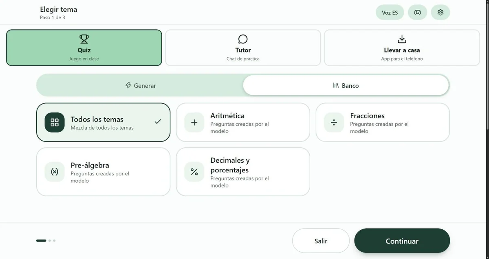
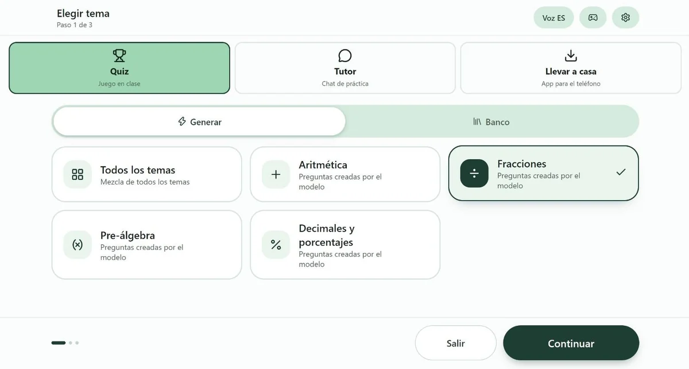
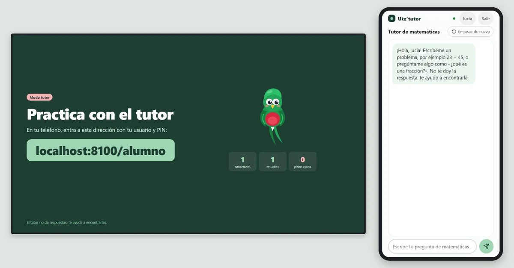
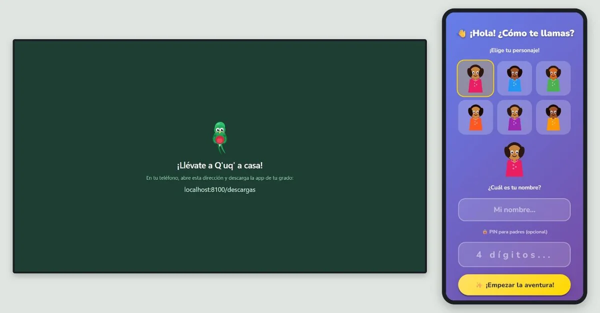
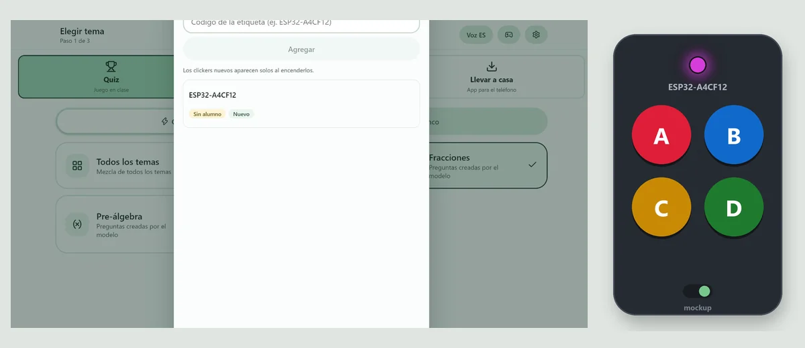
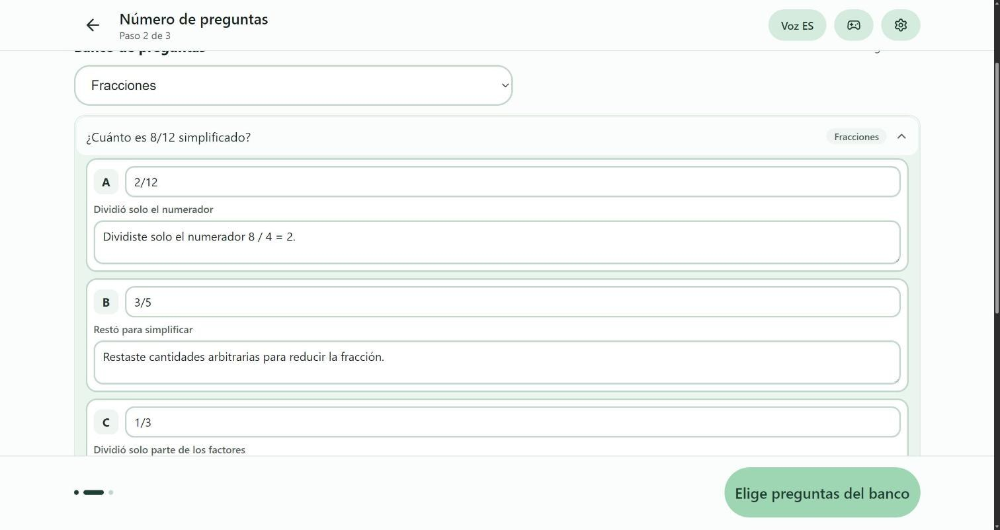
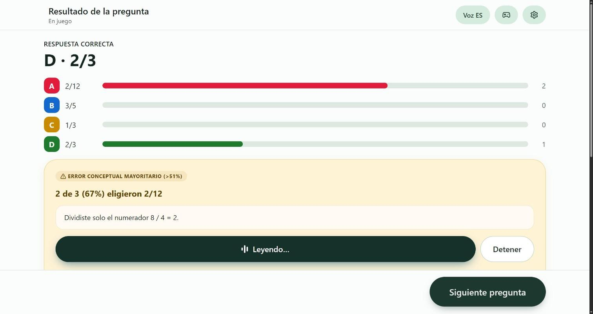
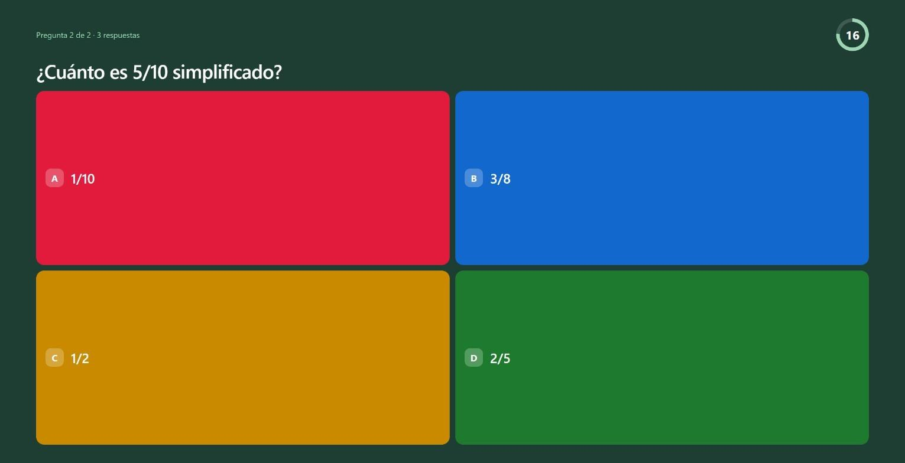
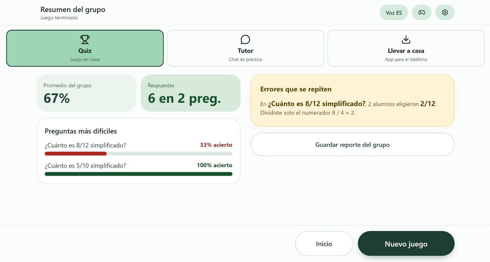
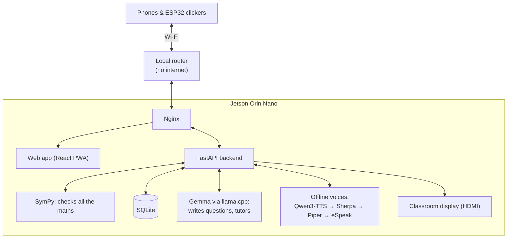

<h1 align="center">Utz'tutor</h1>

<p align="center">
  <a href="https://github.com/GabGP/TutorBox/actions/workflows/ci-backend.yml"></a>
</p>

<div align="center">

| 🏠 **Utz'tutor** | 📚 [Docs](docs/README.md) | ⚙️ [Backend](backend/README.md) | 📱 [PWA](pwa/README.md) | 🔌 [Infra](infra/README.md) |
| :---: | :---: | :---: | :---: | :---: |

📍 **Root Overview** • **Quick Links:** [Architecture](docs/README.md#1-system-architecture--appliance-modes) • [Roadmap](docs/milestones/roadmap.md) • [API Hub](docs/api/README.md) • [Database Schema](docs/database/README.md)

</div>

<p align="center">
  <strong>A classroom AI tutor in a box, for rural schools with no internet at all.</strong><br>
  A small computer and a Wi-Fi router turn any classroom into an interactive maths lesson: students answer on their phones or on cheap button clickers, and the box spots common mistakes and explains them out loud, in Spanish or K'iche'.
</p>

<p align="center">
  
</p>

<p align="center">
  <sub>A real session on a development machine: the teacher builds a fractions quiz, students join, and when most of the class falls for the same wrong answer, the box explains that specific mistake aloud.</sub>
</p>

> [!NOTE]
> Work in progress: this is an engineering capstone project under active development.

---

## Why it exists

Many schools in rural Guatemala have no internet and few resources, and many students learn in K'iche' as well as Spanish. Utz'tutor brings an AI tutor to them anyway: everything, including the language model and the voices, runs on a box in the classroom. Nothing ever needs a connection.

---

## What it does

- **Three modes in one box:** a [classroom quiz](#classroom-quiz) the whole class plays together, a [Socratic tutor](#a-tutor-that-never-gives-the-answer) for practice after class, and [take-home apps](#take-home-apps) with offline games for each grade.
- **Wrong answers that teach.** Every wrong option is designed around a specific mistake ("divided only the numerator", "subtracted to simplify"), so the results show *why* students got it wrong, not just how many.
- **Speaks up when the class is stuck.** If more than 51% of the students pick the same wrong answer, the box explains that mistake aloud, offline, in Spanish or K'iche'.
- **AI that is kept honest.** A small language model on the box (Gemma) writes new questions and talks to students, but a computer algebra engine (SymPy) [checks the maths](#ai-that-is-kept-honest) every time. The model never decides what is correct.
- **Works with or without phones.** Students answer on a phone or on an [ESP32 clicker](#clickers-for-students-without-phones) with four buttons and a light.
- **Safe for kids.** Students log in with a PIN that's stored hashed, never in plain text, and the network is a closed local Wi-Fi.

---

## Classroom quiz

The recording at the top: the teacher picks questions from a bank of 66 (or has new ones written, below), students join, and the results show not just who was right but which mistake the class made. When most of the class falls for the same one, the box explains it out loud, and after the game the teacher gets a short report of the mistakes that keep coming up.

---

## AI that is kept honest

<p align="center">
  
</p>

<p align="center">
  <sub>Three fraction questions written by Gemma on the box. Question 2 failed the check and was dropped.</sub>
</p>

The teacher picks a topic and Gemma writes the questions, each with one right answer and three wrong options built around known mistakes. Before anything reaches the class, SymPy works every problem out on its own:

- the answer marked as correct must equal what SymPy computes,
- no wrong option may secretly be correct too,
- and each wrong option must name a mistake from that topic's list.

A draft that fails goes back to the model with the reason; after three tries the question is dropped. In this recording Gemma marked **2/5** as the answer to a question whose answer is **1/2**: SymPy caught it, and the question never made it into the game. The teacher can still read and edit every question, including the explanations, in the question bank.

---

## A tutor that never gives the answer

<p align="center">
  
</p>

<p align="center">
  <sub>A real practice chat on a student's phone, with the classroom TV in tutor mode.</sub>
</p>

After class, students practise on their phones. When an answer is wrong, the tutor works out *which* mistake it was (4/12 means the tops and the bottoms were added) and replies with a hint from a ladder of up to three, never with the answer. Gemma rewrites each hint in a friendlier voice, and a guard throws the rewrite away if it reveals the answer, loses the problem's numbers or stops asking a question; the planned hint is used instead. In this chat it did exactly that, twice. The classroom TV only shows totals (connected, solved, asking for help), never names.

---

## Take-home apps

<p align="center">
  
</p>

<p align="center">
  <sub>The first-grade app: pick a character, follow Q'uq' the quetzal across the map, and play.</sub>
</p>

In take-home mode the box serves an Android app for each grade (first, second and third) at `/descargas`. Once installed it works with no connection at all: short "look, listen, tap" games that need no reading, one level per competency of the national curriculum (CNB), with progress saved on the phone.

---

## Clickers for students without phones

<p align="center">
  
</p>

<p align="center">
  <sub>The clicker on the right is a drawing, but its light follows the real firmware, which ran here in its PC simulator and voted as mateo.</sub>
</p>

A clicker is a small ESP32-C3 board with four answer buttons and one light. It joins the box's Wi-Fi by itself and appears in the teacher's list; the teacher assigns it to a student once. When a question opens the light blinks white, the student presses A, B, C or D, and the light turns green when the vote is counted. The [build and flashing guide](firmware/clicker/README.md) covers the parts, the wiring and what every light means.

---

## Screenshots

<table>
  <tr>
    <td width="50%" valign="top">
      
      <br><sub><b>The question bank.</b> Each wrong option names the mistake behind it and the feedback the student gets.</sub>
    </td>
    <td width="50%" valign="top">
      
      <br><sub><b>A misconception caught.</b> Two of the three students chose 2/12, so the box reads out why that's wrong.</sub>
    </td>
  </tr>
  <tr>
    <td valign="top">
      
      <br><sub><b>The classroom display,</b> on the projector or TV over HDMI.</sub>
    </td>
    <td valign="top">
      
      <br><sub><b>After the game,</b> a report of the hardest questions and the mistakes that keep coming up.</sub>
    </td>
  </tr>
</table>

<sub>The interface is in Spanish, as used in the classroom. Everything shown was recorded on a development machine, with Gemma 4 running locally through llama.cpp.</sub>

---

## The hardware

| Part | What it does |
| :--- | :--- |
| **NVIDIA Jetson Orin Nano** (8 GB) | The box: serves the web app, runs the language model, the voices, the maths engine and the database, and drives the classroom display over HDMI. |
| **GL.iNet GL-AR300M16 router** | A private Wi-Fi network called `Utz'tutor` that students' phones join. |
| **ESP32-C3 clickers** | Cheap physical answer buttons for students without phones. |

All of it works 100% offline.

---

## Run it

For development you need [uv](https://docs.astral.sh/uv/) and `pnpm`; one command does the rest:

```bash
curl -LsSf https://astral.sh/uv/install.sh | sh   # install uv, if needed
./run.py
```

`run.py` checks what's installed, builds the web app, sets up the database, loads the question bank and starts the server. Then open:

| Who | Address |
| :--- | :--- |
| Teacher | `http://localhost:8000/maestro/` |
| Students | `http://localhost:8000/alumno/` |
| Classroom display | `http://localhost:8000/pantalla/` |
| API documentation | `http://localhost:8000/docs` |

A first teacher account, `teacher1`, is created automatically; change its PIN before real use (see the [authentication docs](docs/api/auth.md)).

- **Without the language model** the question bank and quizzes still work; generating new questions needs `llama-server` on `127.0.0.1:8080`.
- **Voices:** without the neural voice models it falls back to eSpeak-ng. Download better voices with `./run.py --download-models all` (or `minimal`, `kokoro`, `qwen`).
- **A real classroom kit** (the Jetson and its router) is set up with Ansible: follow the [kit setup guide](infra/ansible/README.md), which runs `./run.py --prepare`.

---

## How it's built



- **Backend:** Python 3.11+, FastAPI and WebSockets, SQLite with versioned migrations.
- **Frontend:** a React and Vite progressive web app, served by Nginx from the box.
- **Maths:** SymPy is the only authority on whether an answer is correct.
- **Language model:** Gemma 4 (A2B, quantised to Q4_K_M) through `llama.cpp`.
- **Voices:** Qwen3-TTS for the best Spanish, falling back to Sherpa-ONNX, Piper and finally eSpeak-ng so there is always a voice.

```text
TutorBox/
├── backend/    # FastAPI app: quiz sessions, Socratic tutor, SymPy checks, voices, database
├── pwa/        # teacher, student and classroom-display web apps
├── firmware/   # ESP32-C3 clicker firmware and a PC simulator
├── infra/      # Ansible kit setup, Nginx, systemd, captive portal, router guides
├── tools/      # launcher modules, voice model downloader, benchmarks
├── docs/       # architecture, pedagogy, API and database documentation
└── run.py      # one-command startup
```

---

## Documentation

- [Documentation portal](docs/README.md)
- [The three modes](docs/architecture/three-modes.md) and [how wrong answers diagnose mistakes](docs/architecture/diagnostic-distractors.md)
- [Voice feedback](docs/architecture/voice-feedback.md)
- [REST API](docs/api/README.md) and [database](docs/database/README.md)
- [Backend developer guide](backend/README.md)

---

Made by [@GabGP](https://github.com/GabGP) and [@guillermo-martinez42](https://github.com/guillermo-martinez42).
