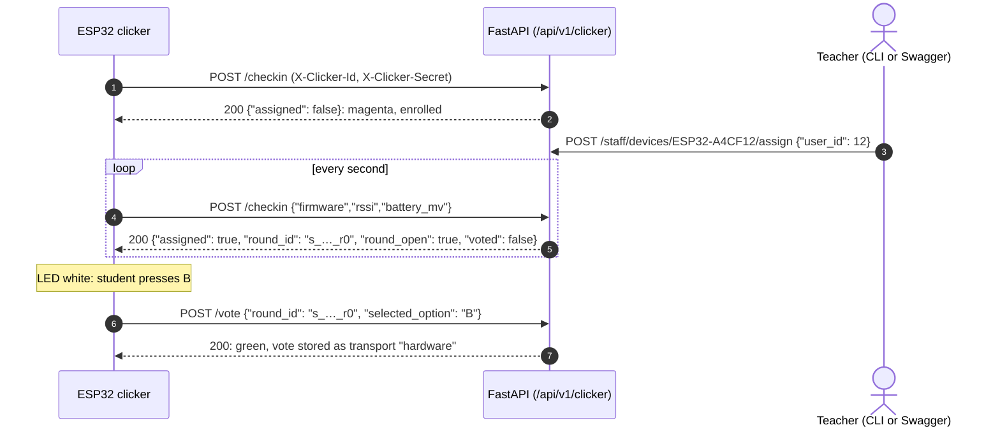

# Hardware Clicker Transport API Specification

How an ESP32 clicker enrolls itself, learns whether a question is open, and votes as the student a teacher assigned to it.

<div align="center">

| 🏠 [TutorBox](../../README.md) | 📚 [Docs](../README.md) | ⚙️ [Backend](../../backend/README.md) | 📱 [PWA](../../pwa/README.md) | 🔌 [Infra](../../infra/README.md) |
| :---: | :---: | :---: | :---: | :---: |

📍 [Docs](../README.md) › [REST API](README.md) › **Hardware Clicker Transport** • **Related:** [Devices API](devices.md) • [Sessions API](sessions.md) • [Clicker Firmware](../../firmware/clicker/README.md) • [ESP32 Clicker Protocol](../architecture/esp32-protocol.md)

</div>

---

## Endpoint Overview

The web vote endpoint (`POST /api/v1/session/{id}/vote`) records every vote as transport `web`, so a phone cannot pose as a clicker. Clickers use these two endpoints instead. Both are called by the firmware in [`firmware/clicker/`](../../firmware/clicker/README.md), never by people.

| Method | Endpoint | Authorization | Description |
| :--- | :--- | :---: | :--- |
| `POST` | `/api/v1/clicker/checkin` | Clicker headers | Enrolls on first contact, records vitals, reports the open round (every second) |
| `POST` | `/api/v1/clicker/vote` | Clicker headers | Records the assigned student's vote as transport `hardware` |

The teacher's side (list, assign, unassign, remove clickers) is the [Devices API](devices.md).

---

## Clicker Authentication

Every request carries two headers. There is no PIN and no bearer token.

```http
X-Clicker-Id: ESP32-A4CF12
X-Clicker-Secret: 3f9c2a8e6b1d4c7f0a5e9d3b8c2f6a1e
```

* **`X-Clicker-Id`**: `ESP32-` plus the last six hex digits of the clicker's Wi-Fi MAC (the router's client list shows the same digits). Must match `^[A-Za-z0-9_.-]{1,32}$`.
* **`X-Clicker-Secret`**: 32 lowercase hex characters (128 random bits) the clicker generates on its first boot and keeps in flash (NVS). Must match `^[0-9a-f]{32,64}$`.
* **Storage**: `devices.secret_hash` holds the secret's SHA-256 digest, never the secret. A random 128-bit secret needs no slow hash (same reasoning as session tokens, [auth.md](auth.md)).
* **Trust on first use**: the first check-in from an unknown id, or from an id a teacher registered by hand, stores its digest. Later requests must present the same secret. Enrolling grants nothing: a clicker votes only after a teacher assigns it to a student, the same trust decision as the BLE design ([esp32-protocol.md §5](../architecture/esp32-protocol.md#5-trust-model-why-bluetooth-always-on-is-safe)).
* **Reset**: a clicker whose flash was erased has a new secret and gets `401`. `DELETE /api/v1/staff/devices/{id}` removes the row and its digest; the clicker re-enrolls, unassigned, on its next check-in.
* **Cap**: self-enrollment stops at 100 registered devices (`MAX_CLICKERS`), so a script on the Wi-Fi cannot flood the roster.



---

## Detailed Contracts

### <a id="post-clicker-checkin"></a>`POST /api/v1/clicker/checkin`

* **Authorization**: Clicker headers (enrolls the clicker on first contact).
* **Request Body** (every field optional):
  ```json
  {
    "firmware": "1.0.0",
    "rssi": -55,
    "battery_mv": 3950
  }
  ```
  | Field | Constraint | Meaning |
  | :--- | :--- | :--- |
  | `firmware` | ≤ 32 chars, `^[A-Za-z0-9_.+-]+$` | Firmware version string. |
  | `rssi` | −127…0 | Wi-Fi signal in dBm. |
  | `battery_mv` | 0…10000 | Battery voltage in millivolts, when the divider is fitted. |
* **Side effects**: vitals and `last_seen_at` are written at most every 15 s per clicker (`SEEN_UPDATE_SECONDS`). The staleness check is a read, so the other 14 check-ins never take SQLite's write lock.
* **Responses**:
  * `200 OK`:
    ```json
    {
      "device_id": "ESP32-A4CF12",
      "assigned": true,
      "round_id": "s_a1b2c3d4e5f6_r0",
      "round_open": true,
      "voted": false
    }
    ```
    | Field | Meaning |
    | :--- | :--- |
    | `assigned` | A teacher linked this clicker to a student. |
    | `round_id` | Current round of the newest lobby/active match, `null` when none. |
    | `round_open` | The vote endpoint would accept a vote now: round status `open` and, when the countdown is in memory, time left. |
    | `voted` | The assigned student already voted in this round, from any transport (a phone answer counts). |
  * `401 Unauthorized`: `"Clicker not recognized: unknown id or wrong secret."`, the id is enrolled with another secret.
  * `403 Forbidden`: the 100-clicker cap is reached and this id is new.
  * `422 Unprocessable Entity`: missing or malformed headers or body fields.

---

### <a id="post-clicker-vote"></a>`POST /api/v1/clicker/vote`

* **Authorization**: Clicker headers. Voting never enrolls: an unknown id is `401`.
* **Request Body**:
  ```json
  {
    "round_id": "s_a1b2c3d4e5f6_r0",
    "selected_option": "B",
    "response_time_ms": 1200
  }
  ```
  The vote is bound to the round the clicker saw open, never to "whatever round is current", so a press for question 3 that arrives after the teacher moved on cannot land on question 4. `response_time_ms` is measured from when the clicker first saw the round open.
* **Behaviour**: calls the same `QuizSessionEngine.cast_vote` as the web endpoint with `transport_type="hardware"` and the clicker's `device_id`, for `student_id = devices.assigned_user_id`. The first-press lock `UNIQUE(round_id, student_id)` is shared across transports.
* **Responses**:
  * `200 OK`:
    ```json
    {
      "vote_id": "v_a1b2c3d4e5f6",
      "round_id": "s_a1b2c3d4e5f6_r0",
      "selected_option": "B",
      "recorded_at": "2026-10-09 18:20:01"
    }
    ```
  * `401 Unauthorized`: unknown clicker or wrong secret.
  * `403 Forbidden`: `"Clicker is not assigned to any student."`
  * `404 Not Found`: `"Round not found."`
  * `409 Conflict`: already voted in this round (any transport), round not `open`, or the voting window expired. Final: the firmware shows red and does not retry.
  * `422 Unprocessable Entity`: option outside `A`–`D`, malformed `round_id`, negative response time.

---

## Firmware Behaviour Contract

What the backend can rely on from the clicker ([`ClickerApp.cpp`](../../firmware/clicker/clicker/ClickerApp.cpp)):

| Rule | Detail |
| :--- | :--- |
| One request in flight | A check-in or a vote, never both; check-ins pause while a vote is pending. |
| Check-in cadence | 1 s normally, 2 s after a failure, 5 s while refused (`401`/`403`/`422`). |
| Votes only when armed | Sent only if the last check-in said `round_open` and not `voted`, and the clicker has not answered this `round_id`. |
| Network retries | A vote that got no HTTP answer is retried twice, 250 ms apart. A `409` on a retry means the first attempt arrived, and is shown as counted. |
| Wi-Fi loss | A vote not yet sent is dropped and shown red, never sent late. |

Measured on the development container (FastAPI + SQLite, no nginx), 30 simulated clickers checking in every second through a 3-question match: check-in p50 5 ms / p95 43 ms, vote p50 7 ms / p95 12 ms, 90 of 90 votes recorded (`python tools/clickers/clickers.py simulate 30 --auto-assign`). Re-measure on the Jetson for the Week 7 fleet report.

---

## Related Specifications

* **[Clicker Firmware](../../firmware/clicker/README.md)**: wiring, flashing, LED meanings, troubleshooting.
* **[Devices API](devices.md)**: the teacher's clicker list, assignment and removal.
* **[Database: `devices`](../database/core.md#table-devices)**: `secret_hash` and fleet-health columns (migration 012).
