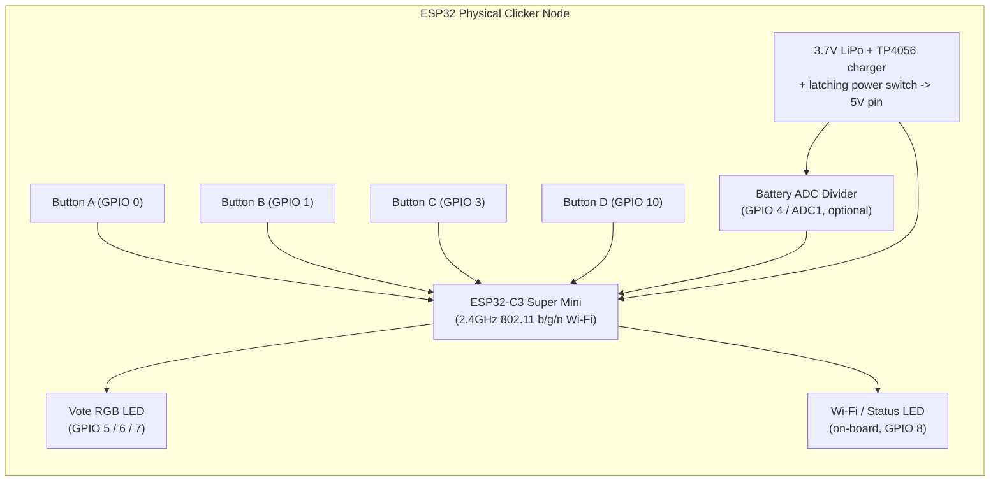
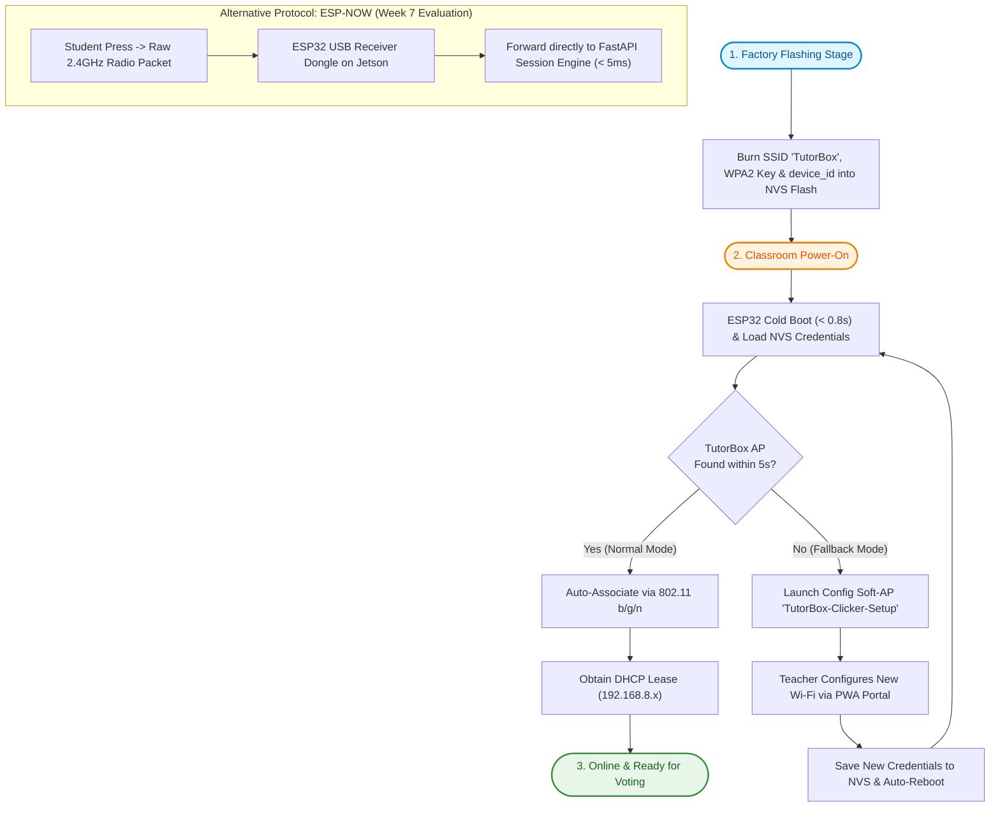
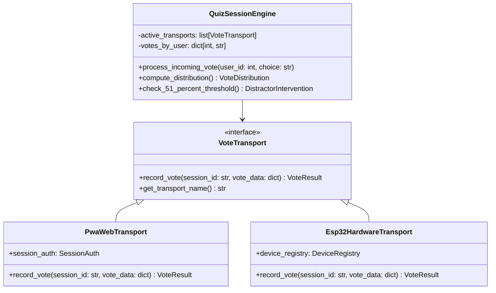
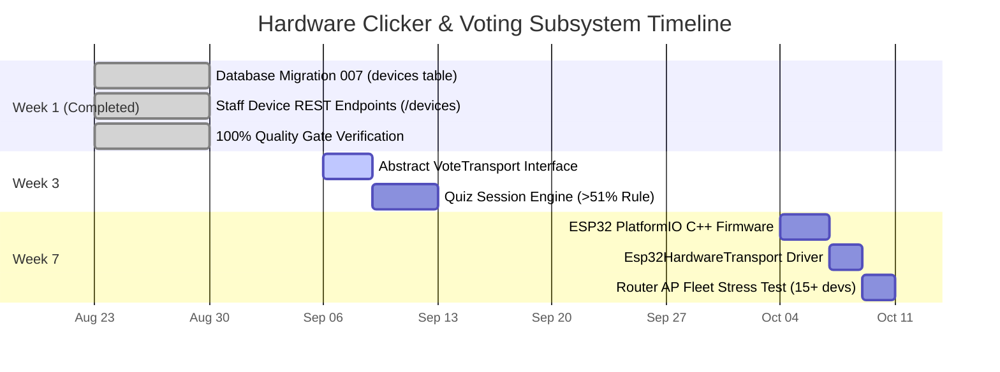

# ESP32 Hardware Clicker Architecture & Transport Specification

Comprehensive engineering specification for the **TutorBox Physical Clicker Subsystem**, detailing hardware design, network transport, AP association, telemetry monitoring, teacher pairing lifecycle, and the abstract `VoteTransport` interface.

<div align="center">

| 🏠 [TutorBox](../../README.md) | 📚 [Docs](../README.md) | ⚙️ [Backend](../../backend/README.md) | 📱 [PWA](../../pwa/README.md) | 🔌 [Infra](../../infra/README.md) |
| :---: | :---: | :---: | :---: | :---: |

📍 [Docs](../README.md) › **Architecture** › **ESP32 Clicker Transport** • **Related:** [Hardware Topology](hardware-topology.md) • [Three Modes](three-modes.md) • [Database Schema](../database/README.md)

</div>

---

> [!NOTE]
> **Work in Progress & Tentative Engineering Blueprint**:
> This document represents an evolving architectural specification prepared ahead of the hardware development milestones. The interface contracts, transport protocols, telemetry payloads, and hardware benchmarks will be expanded and refined during **Week 3 (Session Engine & Abstract Transport)** and finalized in **Week 7 (ESP32 Hardware Clickers & Fleet Testing)**.

---

## Table of Contents
- [1. Subsystem Overview & Pedagogical Purpose](#1-subsystem-overview--pedagogical-purpose)
- [2. Hardware Specifications & Bill of Materials](#2-hardware-specifications--bill-of-materials)
- [3. Wi-Fi AP Association & Provisioning Mechanisms](#3-wi-fi-ap-association--provisioning-mechanisms)
- [4. End-to-End Communication Flow & Pairing Model](#4-end-to-end-communication-flow--pairing-model)
- [5. Abstract `VoteTransport` Architecture (Week 3 & Week 7 Bridge)](#5-abstract-votetransport-architecture-week-3--week-7-bridge)
- [6. Visual Feedback & Dual LED State Machines](#6-visual-feedback--dual-led-state-machines)
- [7. Fleet Health Telemetry & Teacher PWA Dashboard](#7-fleet-health-telemetry--teacher-pwa-dashboard)
- [8. Concurrency, Latency & Edge Case Resilience](#8-concurrency-latency--edge-case-resilience)
- [9. Implementation Roadmap & Milestones](#9-implementation-roadmap--milestones)
- [Next Steps](#next-steps)

---

## <a id="1-subsystem-overview--pedagogical-purpose"></a>1. Subsystem Overview & Pedagogical Purpose

In rural and primary classroom environments (grades 1–6, ages 6–12), asking students to type alphanumeric usernames and PINs on small screens is a significant pedagogical friction point.

The **TutorBox Physical Clicker Subsystem** provides a dedicated, tactile 4-button hardware alternative (A, B, C, D) for the **Classroom Quiz Mode**:
* **Zero Student Setup**: Students pick up their numbered clicker (e.g. `#5`) and immediately participate.
* **Delegated Authorization**: The teacher links clicker IDs to student accounts via the Teacher PWA in seconds.
* **Dual Feedback Loop**: Both the handheld RGB LED and the classroom HDMI projector visually confirm vote ingestion.
* **Centralized Fleet Health**: Battery levels and connectivity are automatically reported to the teacher's dashboard, removing hardware management cognitive load from young students.
* **Decoupled Engine**: Built on the abstract `VoteTransport` interface, allowing the session engine to process votes identically regardless of whether the source is a mobile web client (PWA) or an ESP32 hardware clicker.

---

## <a id="2-hardware-specifications--bill-of-materials"></a>2. Hardware Specifications & Bill of Materials



> [!NOTE]
> **Pin map corrected in Week 7.** The earlier map put the buttons on GPIO 18/19/21/22 and the LEDs on 8/9.
> On the ESP32-C3, GPIO 18/19 are the USB data lines (flashing and the serial log), GPIO 21 is serial TX,
> GPIO 22 does not exist, and GPIO 8/9 are boot-strapping pins (9 is the BOOT button). The map below is
> the one the firmware uses ([`config.h`](../../firmware/clicker/clicker/config.h)); wiring diagrams are
> in the [firmware guide](../../firmware/clicker/README.md).

### Component Breakdown:
| Component | Specification | Purpose |
| :--- | :--- | :--- |
| **Microcontroller (MCU)** | ESP32-C3 Super Mini (ESP32-C3FH4, native USB-C) | 160MHz RISC-V core, 2.4GHz Wi-Fi. Other C3 boards work with the same GPIO numbers. |
| **Input Buttons** | 4x momentary tactile push buttons, GPIO 0 / 1 / 3 / 10 to GND | Options A, B, C, D. Internal pull-ups, 30 ms debounce, press edges latched by interrupt so a tap during a network call still counts. |
| **Vote / Feedback LED** | 1x common-cathode RGB LED on GPIO 5 / 6 / 7 (220 Ω red, 100 Ω green and blue) | What the student watches (section 6). |
| **Status / Wi-Fi LED** | On-board blue LED, GPIO 8, active-low | Steady = Wi-Fi up, blinking = searching. |
| **Battery Sense (ADC)** | 2x 100kΩ divider to GPIO 4 (ADC1), optional | Battery voltage ($3.0\text{V} - 4.2\text{V}$), reported on every check-in. |
| **Power & Charging** | 3.7V LiPo (≥ 1000 mAh with a stock 1 A TP4056) + TP4056 USB-C module + latching push switch to the 5V pin. Simpler: a 3xAA box with built-in switch. | One school day per charge (measure it in the fleet test). |
| **Physical Enclosure** | 3D-printed PLA / Injection Molded Case | Durable casing with visible laser-engraved/sticker number (e.g. `1`..`30`). |

---

## <a id="3-wi-fi-ap-association--provisioning-mechanisms"></a>3. Wi-Fi AP Association & Provisioning Mechanisms

A common question in offline hardware design is: **How does each physical clicker connect to the appliance's local Wi-Fi Access Point without a screen or keyboard?**

> [!IMPORTANT]
> **Built in Week 7: strategy 1 (factory provisioning) plus self-enrollment.** The Wi-Fi name and passphrase
> are flashed with the firmware (`secrets.h`, git-ignored). There is no per-clicker flashing step: each clicker
> derives its `device_id` from its MAC, generates its own secret, and enrolls on its first check-in; the teacher
> then assigns it to a student ([Clicker API](../api/clicker.md)). The soft-AP portal (strategy 2) and ESP-NOW
> (strategy 3) were not built. The BLE design in [ESP32 Clicker Protocol](esp32-protocol.md) remains the
> hardening path; its status note explains the choice.

TutorBox evaluates three connectivity strategies, with **Factory Fleet Provisioning** serving as the primary design:



### 1. Primary Strategy: Appliance Factory Provisioning (Zero-Touch)
* **Pre-Shared Appliance Network**: Every TutorBox appliance kit includes a pre-configured router (GL-AR300M16) with fixed network parameters:
  - **SSID**: `TutorBox`
  - **WPA2 Pre-Shared Key**: Configured in appliance manufacturing
  - **Backend API**: `http://192.168.8.2/api/v1` (Jetson static lease; see [ESP32 Clicker Protocol](esp32-protocol.md))
* **Firmware Embedding**: When the batch of 30 clickers is flashed in Week 7, the Wi-Fi credentials, gateway IP, and unique `device_id` (e.g. `"1"`, `"2"`, `"ESP32_01"`) are burned into the ESP32 Non-Volatile Storage (NVS).
* **Classroom Experience**: The student simply turns on the device switch. The ESP32 boots in $< 0.8\text{s}$, automatically associates to the `TutorBox` AP, and enters the low-power listening loop. **Zero configuration is required in the classroom.**

### 2. Secondary Strategy: Captive Portal / BLE Provisioning Fallback
* If the appliance router SSID or security key is modified:
  - If the ESP32 fails to connect after 5 seconds, it enters provisioning mode (blinking blue).
  - It hosts a temporary setup soft-AP (`TutorBox-Clicker-Config`) allowing the teacher or administrator to update network credentials once from a mobile phone browser.

### 3. Alternative Protocol: ESP-NOW Direct Radio Broadcast (Week 7 Exploration)
* **How It Works**: ESP-NOW is a connectionless 2.4GHz protocol developed by Espressif that transmits raw peer-to-peer radio packets without Wi-Fi association or IP stack overhead.
* **Benefits**:
  - Eliminates Wi-Fi association times (transmission takes $< 5\text{ms}$).
  - Bypasses router client association limits (supports 100+ concurrent clickers without saturating the router's DHCP pool).
  - A small ESP32 USB dongle connected to the Jetson Orin Nano receives raw radio packets and forwards them to FastAPI via local serial or loopback.

---

## <a id="4-end-to-end-communication-flow--pairing-model"></a>4. End-to-End Communication Flow & Pairing Model

TutorBox utilizes a **Teacher-Delegated Trust Model** to eliminate student authentication barriers on hardware clickers while maintaining strict tenant isolation.

```mermaid
sequenceDiagram
    autonumber
    actor Teacher as Teacher (PWA Portal)
    participant API as FastAPI Backend (:8000)
    participant DB as SQLite DB (`devices`)
    actor Student as Student (Clicker #1)
    participant ESP32 as ESP32 Clicker
    participant Screen as Classroom HDMI Display

    Note over Teacher,DB: Step 1: Teacher Pairing (In-Band Auth)
    Teacher->>API: POST /api/v1/devices/1/assign {"user_id": 12} (Bearer Token)
    API->>DB: UPDATE devices SET assigned_user_id = 12 WHERE device_id = '1'
    API-->>Teacher: 200 OK {"device_id": "1", "assigned_user_id": 12, "assigned_username": "juan_p"}

    Note over Student,Screen: Step 2: Quiz Turn & Voting + Telemetry
    Teacher->>API: POST /api/v1/session/{id}/start (Voting Window Opens)
    API->>Screen: Render Question & A-D Options on HDMI Display (/pantalla/)
    Student->>ESP32: Presses Button 'B'
    ESP32->>ESP32: Vote LED = BLINK YELLOW (TX in-flight)
    ESP32->>API: POST /api/v1/session/{id}/vote {"selected_option": "B", "transport_type": "hardware", "device_id": "1", "response_time_ms": 1200.0}
    API->>DB: INSERT INTO quiz_session_votes (round_id, student_id, selected_option, ...)
    Note over API: Enforces first-press lock (UNIQUE round_id, student_id); maps device_id '1' -> student_id 12
    API-->>ESP32: 200 OK {"status": "recorded", "selected_option": "B"}
    ESP32->>ESP32: Vote LED = SOLID GREEN (1.5s)
    API->>Screen: Update live aggregate turnout count
    API->>Teacher: Live turnout update on /maestro/ console
```

---

## <a id="5-abstract-votetransport-architecture-week-3--week-7-bridge"></a>5. Abstract `VoteTransport` Architecture (Week 3 & Week 7 Bridge)

To enforce **System Guardrail #5 (Hardware-Agnostic Transport)**, voting logic is decoupled from client implementations:



> [!NOTE]
> **Architectural Decision (Week 3 Evaluation): Wire Protocol Seam vs. In-Process OOP Abstraction**
> While early design diagrams envisioned an in-memory Python class hierarchy (`VoteTransport` OOP interface), distributed heterogeneous clients (ESP32 microcontrollers running embedded C++ and student smartphones running JavaScript PWA) operate over physical network boundaries and cannot share an in-memory Python runtime.
>
> Therefore, the **Wire Protocol contract (`POST /api/v1/session/{id}/vote`)** serves as the true hardware-agnostic transport layer. The payload accepts `"transport_type": "web" | "hardware" | "mock"` alongside optional `"device_id"`, decoupling client implementations from server state without artificial in-process OOP boilerplate.
>
> This architecture is formally validated in Week 3 via an automated 15-client concurrent test match (`test_session_concurrency.py`), proving 100% first-press lock enforcement and 0 lost votes under simultaneous mixed web and hardware traffic. See [ESP32 Clicker Protocol](esp32-protocol.md) for the complete provisioning and HTTP voting flow.

---

## <a id="6-visual-feedback--dual-led-state-machines"></a>6. Visual Feedback & Dual LED State Machines

The clicker has one **RGB LED** the student watches, plus the Super Mini's small **on-board blue LED** for bench diagnostics. As built in Week 7 ([`ClickerApp.cpp`](../../firmware/clicker/clicker/ClickerApp.cpp)); the firmware guide has the same table for teachers.

### A. RGB LED (as built)
| What it means | LED | Who acts |
| :--- | :--- | :--- |
| Looking for the `TutorBox` Wi-Fi | 🔵 Blue, fast blink | Nobody (check the router if it lasts > 30 s) |
| Wi-Fi up, first check-in pending | 🔵 Blue, steady | Nobody |
| Wi-Fi up but the TutorBox does not answer | 🔵 Blue, slow blink (1 s / 1 s) | Teacher: is the Jetson on? |
| Not assigned to a student yet | 🟣 Magenta, slow blink | Teacher assigns it (`clickers.py assign`) |
| Refused by the TutorBox (secret mismatch) | 🟣 Magenta, fast blink | Teacher removes it (`clickers.py forget`), it re-enrolls |
| Ready, no question open | 🟢 Short green blip every 3 s | Nobody |
| **Question open: answer now** | ⚪ White, slow blink | **Student presses A–D** |
| Sending the vote | 🟡 Yellow, steady | Nobody |
| Vote counted | 🟢 Green, steady 1.5 s | Nobody |
| Not accepted (already answered, time up, no question) | 🔴 Red ×3 | Student waits for the next question |
| Button while the clicker needs the teacher | 🟣 Magenta ×3 | Teacher |

### B. On-board status LED (GPIO 8)
| State | Pattern |
| :--- | :--- |
| Searching for Wi-Fi | Blinking |
| Wi-Fi connected | Steady |

Charging is shown by the TP4056 module's own LEDs (red = charging, blue/green = full).

---

## <a id="7-fleet-health-telemetry--teacher-pwa-dashboard"></a>7. Fleet Health Telemetry & Teacher PWA Dashboard

While the physical clicker has local LED warnings, **primary school students should not be responsible for diagnosing battery or network issues**.

Instead, TutorBox transmits real-time telemetry from every clicker directly to the **Teacher PWA Fleet Dashboard**:

### 1. In-Flight Telemetry Payload
As built: every check-in (once a second) carries the vitals; the appliance stores them at most every 15 s
([Clicker API](../api/clicker.md#post-clicker-checkin)). The device is identified by the `X-Clicker-Id` header.
```json
{
  "firmware": "1.0.0",
  "rssi": -55,
  "battery_mv": 3950
}
```
`GET /api/v1/staff/devices` returns them per clicker with `online` (checked in within 45 s), and
`python tools/clickers/clickers.py list` prints the fleet table below from a laptop. The PWA grid itself is
not built yet.

### 2. Teacher Fleet Health View (PWA UI)
In the Teacher Device Management view (`GET /devices`), the teacher sees a live status grid:

| Clicker # | Assigned Student | Status | Battery Level | Signal (RSSI) | Quick Action |
| :--- | :--- | :--- | :--- | :--- | :--- |
| **`#01`** | Juan Pérez | 🟢 Online | 🔋 88% | 📶 -55 dBm *(Good)* | `[Unpair]` |
| **`#02`** | María Gómez | 🟢 Online | 🔋 92% | 📶 -48 dBm *(Strong)* | `[Unpair]` |
| **`#03`** | Carlos Ruiz | 🟢 Online | 🪫 14% *(Low Alert)* | 📶 -62 dBm *(Moderate)* | `[Unpair]` |
| **`#04`** | *(Unassigned)* | ⚪ Standby | 🔋 100% | 📶 -50 dBm *(Strong)* | `[Pair Student]` |
| **`#05`** | Ana Morales | 🔴 Offline | ❓ Unknown | ❌ No Signal | `[Unpair]` |

* **Low-Battery Proactive Alerts**: If a clicker drops below $20\%$, the teacher sees a yellow warning icon and can swap the unit before starting a quiz.
* **Signal Quality (RSSI)**: Detects if a student is sitting in a Wi-Fi blind spot in the classroom.
* **Zero Student Confusion**: Students only interact with the simple 4 buttons and the green confirmation light.

---

## <a id="8-concurrency-latency--edge-case-resilience"></a>8. Concurrency, Latency & Edge Case Resilience

### 1. Button Debounce & Lockout
* As built: a press counts at once on its first edge (the pin interrupt latches it, so a tap made during a network call is not lost); the button must then be released for **30 ms** before it can count again, which absorbs contact bounce and long holds ([`Buttons.cpp`](../../firmware/clicker/clicker/Buttons.cpp)).
* While a vote is in flight, further presses are ignored; a second press in an answered round is refused locally (red ×3) without a request.

### 2. First-Press Locking (No In-Window Overrides)
* First press locks: a student can only submit one vote per question round. Any second press in the same round is rejected with `409 Conflict` at the engine level and via `UNIQUE(round_id, student_id)` at the database layer. Firmware must treat `409` as final (red blink) and not retry as an update.

### 3. Unassigned Clicker Defense
* If an unassigned clicker sends a vote, the backend rejects with `403 Forbidden` (`{"detail": "Clicker is not assigned to any student."}`). As built, an unassigned clicker already knows it from its check-in and blinks magenta, so it never sends that vote.

### 4. Router AP Capacity & Connection Budget
* The **GL-AR300M16 router** handles up to 30 simultaneous 802.11 b/g/n Wi-Fi stations on the 2.4GHz band.
* ESP32 firmware utilizes static IP assignment or cached DHCP leases to maintain connection latency under **150ms** per vote packet.

---

## <a id="9-implementation-roadmap--milestones"></a>9. Implementation Roadmap & Milestones



---

## Next Steps

* **[Hardware Devices API Spec](../api/devices.md)**: Explore the `/staff/devices` and student pairing endpoint specifications.
* **[Database Schema Reference](../database/README.md)**: Review table definitions and ER relationships.
* **[Hardware Topology](hardware-topology.md)**: Explore overall edge appliance hardware and RAM budgets.
