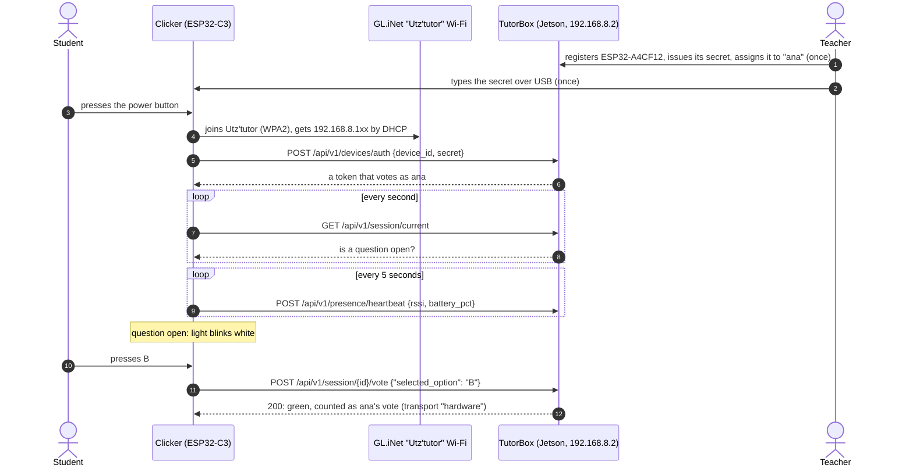
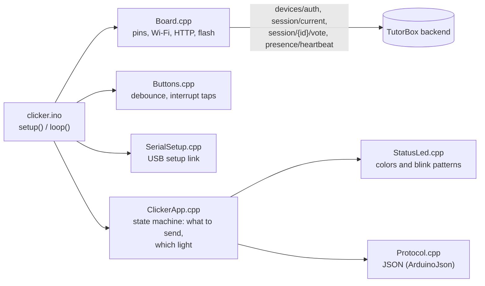

# ESP32-C3 Hardware Clicker: Build, Flash & Classroom Guide

Four answer buttons, one power button, one light. Turn it on and it joins the `Utz'tutor` Wi-Fi by itself; when the teacher opens a question the light blinks white and the student presses A, B, C or D.

<div align="center">

| 🏠 [TutorBox](../../README.md) | 📚 [Docs](../../docs/README.md) | ⚙️ [Backend](../../backend/README.md) | 📱 [PWA](../../pwa/README.md) | 🔌 [Infra](../../infra/README.md) |
| :---: | :---: | :---: | :---: | :---: |

📍 [Docs](../../docs/README.md) › **Clicker Firmware** • **Related:** [Devices API](../../docs/api/devices.md) • [Presence API](../../docs/api/presence.md) • [ESP32 Clicker Transport](../../docs/architecture/esp32-clicker-transport.md) • [GL.iNet AP Setup](../../infra/glinet/initial.md)

</div>

---

## Table of Contents
- [1. How It Works](#1-how-it-works)
- [2. Parts per Clicker](#2-parts-per-clicker)
- [3. Which Board Do You Have?](#3-which-board-do-you-have)
- [4. Pin Map](#4-pin-map)
- [5. Wiring](#5-wiring)
- [6. Install the Software and Flash](#6-install-the-software-and-flash)
- [7. First Power-On, USB Setup and Assigning a Student](#7-first-power-on-and-assigning-a-student)
- [8. What the Light Means](#8-what-the-light-means)
- [9. Bench Test Checklist](#9-bench-test-checklist)
- [10. Troubleshooting](#10-troubleshooting)
- [11. How the Code Is Organized](#11-how-the-code-is-organized)
- [12. Testing Without Hardware](#12-testing-without-hardware)
- [13. Known Limits](#13-known-limits)

---

## <a id="1-how-it-works"></a>1. How It Works



* **The clicker speaks the same API as the phones.** It logs in, polls the public match state and votes on the same endpoint. The server labels the vote `hardware`, with the clicker's id, from the clicker's token.
* **Two things are set once per clicker.** The Wi-Fi name and password are flashed with the firmware (§6). The clicker's own secret is issued by the TutorBox and typed in over USB (§7). Each clicker names itself from its MAC address (`ESP32-A4CF12`).
* **The teacher assigns each clicker to a student.** It then votes as that student until it is reassigned. Reassigning needs no USB cable: the clicker logs in again and gets a token for the new student.
* **The router needs no changes.** It already serves DHCP to `192.168.8.100–249` and keeps the Jetson at `192.168.8.2` ([GL.iNet runbook §5](../../infra/glinet/initial.md#5-step-3--lan-dhcp--the-jetson-static-lease)).

---

## <a id="2-parts-per-clicker"></a>2. Parts per Clicker

| Part | Qty | Notes |
| :--- | :---: | :--- |
| ESP32-C3 Super Mini | 1 | The tiny board with a USB-C port and BOOT/RST buttons. See §3 if yours looks different. |
| Tactile push button, 12×12 mm, with caps | 4 | Answers A, B, C, D. Colored caps help young children. |
| RGB LED, 5 mm, **common cathode**, diffused | 1 | Diffused looks better than water-clear. |
| Resistor 220 Ω | 1 | Red leg of the LED. |
| Resistor 100 Ω | 2 | Green and blue legs (they need more help at 3.3 V). |
| Latching push switch (self-locking, 8×8 mm or 12 mm) | 1 | **The power button**: push = on, push again = off. A mini slide switch works the same. |
| LiPo battery 3.7 V, **≥ 1000 mAh**, with protection | 1 | Size it to the charger, see the warning in §5. |
| TP4056 USB-C charger module **with protection** (6 pads: IN, B+/B−, OUT+/OUT−) | 1 | Charges the LiPo through its own USB-C port. |
| Electrolytic capacitor 100 µF, ≥ 10 V | 1 | Across 5V and GND near the board: steadies Wi-Fi power peaks. |
| Resistor 100 kΩ | 2 | Optional: lets the teacher see the battery level. |
| Wire, perfboard or breadboard, case | — | A **data** USB-C cable for flashing (charge-only cables do not work). |

**Simpler power option:** a 3×AA battery box with a built-in ON/OFF switch replaces the LiPo, TP4056 and push switch: red wire to `5V`, black to `G`. Use rechargeable NiMH or alkaline cells.

---

## <a id="3-which-board-do-you-have"></a>3. Which Board Do You Have?

| Board | How to recognize it | What changes |
| :--- | :--- | :--- |
| **ESP32-C3 Super Mini** (expected) | About 22×18 mm, USB-C, two tiny buttons (BOOT, RST), 16 pins labeled `5V G 3.3 4 3 2 1 0` and `5 6 7 8 9 10 20 21` | Nothing: the defaults in `config.h` are for it. |
| ESP32-C3-DevKitM-1 | Long board, 2×15 pins, an RGB "NeoPixel" LED next to the module | Set `PIN_STATUS_LED` to `-1` (its GPIO 8 LED is not a simple LED). Same GPIO numbers otherwise. |
| LOLIN / Wemos C3 Mini | Wemos D1-mini size, 2×8 pins | Its on-board RGB LED listens on GPIO 7 (our blue): wire the blue LED to GPIO 4 instead and set `PIN_LED_BLUE 4` (then battery sense cannot use GPIO 4). |

Every ESP32-C3 board uses the same chip, so the GPIO numbers are the same everywhere: always wire by the **label printed next to the pin**, not by counting positions.

---

## <a id="4-pin-map"></a>4. Pin Map

| Function | GPIO | Why this pin |
| :--- | :---: | :--- |
| Button A | 0 | Free general-purpose pin |
| Button B | 1 | Free general-purpose pin |
| Button C | 3 | Free general-purpose pin |
| Button D | 10 | Free general-purpose pin |
| LED red | 5 | Free output |
| LED green | 6 | Free output |
| LED blue | 7 | Free output |
| On-board blue LED | 8 | Already on the board, lit when LOW |
| Battery sense (optional) | 4 | ADC1 input |
| **Do not use** | 2, 8, 9 | Boot "strapping" pins: wiring them wrong stops the board from starting (9 is the BOOT button) |
| **Do not use** | 20, 21 | Serial port, and next to the antenna on the Super Mini |
| Power in | `5V` | From the power switch (3.3–6 V accepted; the board makes its own 3.3 V) |
| Ground | `G` | Shared by buttons, LED, battery |

The buttons need **no resistors**: the chip's internal pull-up holds each pin HIGH, and pressing the button connects it to GND (LOW).

---

## <a id="5-wiring"></a>5. Wiring

Match the labels printed on your board. The drawing shows the Super Mini from the top with USB-C up; some batches print the labels on the back.

```text
                       ESP32-C3 Super Mini (top view, USB-C up)
                              ┌──────[ USB-C ]──────┐
     LED red   ─ 220 Ω ───────┤ 5               5V  ├──── from the power switch (+)
     LED green ─ 100 Ω ───────┤ 6                G  ├──── GND rail (−)  ← everything's ground
     LED blue  ─ 100 Ω ───────┤ 7              3.3  ├     (not used)
                (leave free)  ┤ 8                4  ├──── battery sense (optional)
                (leave free)  ┤ 9                3  ├──── button C ── GND
     button D ── GND ─────────┤ 10               2  ├     (leave free)
                (leave free)  ┤ 20               1  ├──── button B ── GND
                (leave free)  ┤ 21               0  ├──── button A ── GND
                              └─────────────────────┘

  Buttons:   GPIO ──┤ button ├── GND      use two DIAGONALLY opposite legs of the 4-leg button
  RGB LED:   longest leg (common cathode) ── GND
  Power:     LiPo+ → TP4056 B+     LiPo− → TP4056 B−
             TP4056 OUT+ → power switch → 5V          TP4056 OUT− → G
             100 µF capacitor: + leg to 5V, striped (−) leg to G
  Battery sense (optional):  switched battery+ → 100 kΩ → GPIO 4 → 100 kΩ → G
```

Step by step:

1. **Buttons.** Each 12 mm button has 4 legs connected in pairs. Use two legs that are **diagonally opposite**: one to the button's GPIO (A→0, B→1, C→3, D→10), the other to the GND rail.
2. **RGB LED.** The longest leg is the common cathode: to GND. Find which other leg is red, green and blue with the test sketch in §9 (orders vary by maker). Put the 220 Ω resistor in the red leg and 100 Ω in green and blue, then to GPIO 5, 6 and 7.
3. **Power.** Battery to the TP4056 `B+`/`B−`. TP4056 `OUT+` through the power switch to the board's `5V` pin; `OUT−` to `G`. Add the 100 µF capacitor across `5V` and `G`, minus stripe to `G`.
4. **Optional battery sense.** Two 100 kΩ resistors in series from the switched battery `+` to `G`; their middle point to GPIO 4. Then set `PIN_BATTERY_SENSE 4` in `config.h`.

> [!WARNING]
> **LiPo safety.** A stock TP4056 module charges at **1 A**, which is too much for a battery smaller than 1000 mAh. Use ≥ 1000 mAh, or replace the module's `R3` program resistor (1.2 kΩ) with 2.4 kΩ for 500 mA. Use cells and modules **with protection**, never short the battery leads, and charge where an adult can see them.

> [!CAUTION]
> **Switch the clicker OFF before plugging the ESP32's own USB-C cable** (to flash or read the log). With the power switch on, USB 5 V and the battery would be connected together. Charging through the TP4056's USB-C port is fine at any time.

---

## <a id="6-install-the-software-and-flash"></a>6. Install the Software and Flash

### Step 0: the Wi-Fi password (both options)

In `firmware/clicker/clicker/`, copy `secrets.example.h` to **`secrets.h`** and type the real password:

```cpp
#define WIFI_SSID "Utz'tutor"
#define WIFI_PASSWORD "the-classroom-passphrase"
```

`secrets.h` is git-ignored, so the classroom password never reaches GitHub. The TutorBox address (`TUTORBOX_URL`, default `http://192.168.8.2`) and the pins are in `config.h`.

### Option A: Arduino IDE 2 (easiest)

1. Install [Arduino IDE 2](https://www.arduino.cc/en/software).
2. **File → Preferences → Additional boards manager URLs**: add `https://espressif.github.io/arduino-esp32/package_esp32_index.json`.
3. **Tools → Board → Boards Manager**: install **esp32 by Espressif Systems** (3.x).
4. **Tools → Manage Libraries**: install **ArduinoJson** by Benoit Blanchon (7.x).
5. **File → Open**: `firmware/clicker/clicker/clicker.ino`. The other files open as tabs.
6. In the **Tools** menu:
   * **Board**: *Nologo ESP32C3 Super Mini* (or *ESP32C3 Dev Module* on any C3 board)
   * **USB CDC On Boot**: *Enabled* (otherwise the Serial Monitor stays empty)
   * **Flash Mode**: *DIO*
   * **Port**: the COM port that appears when you plug the board in
7. Click **Upload** (→). Then open **Tools → Serial Monitor** at **115200** baud.

### Option B: PlatformIO (VS Code)

```bash
cd firmware/clicker
pio run -t upload        # build and flash
pio device monitor       # serial log, 115200
```

`platformio.ini` pins the official `espressif32` platform (Arduino core 2.0.17) and ArduinoJson 7. The same source builds on the 3.x core the Arduino IDE installs.

### If the upload does not start

Put the board in download mode by hand: **hold BOOT, tap RST, release BOOT**, then upload again. Press **RST** afterwards to run the new firmware. Windows 10/11 needs no driver for the C3's native USB.

---

## <a id="7-first-power-on-and-assigning-a-student"></a>7. First Power-On, USB Setup and Assigning a Student

With the USB cable connected (power switch **off**), the Serial Monitor shows:

```text
=========== TutorBox clicker ===========
Device id : ESP32-A4CF12   <- write it on the case
Firmware  : 2.0.0
Wi-Fi     : Utz'tutor
TutorBox  : http://192.168.8.2
=========================================
[clicker] no secret in flash yet: this clicker needs USB setup
[wifi] connected: IP 192.168.8.112, signal -54 dBm
[ESP32-A4CF12] Wi-Fi connected
[ESP32-A4CF12] No secret yet: set ESP32-A4CF12 up over USB (README: USB setup)
```

The light blinks magenta fast. Three steps follow, once per clicker.

1. **Write the device id on a sticker** on the case. The router's client list shows the same last six digits and the hostname `clicker-a4cf12`.
2. **Register it.** On `/maestro/`, open **Clickers** and add the clicker by the id on its sticker. It is listed as `Sin configurar` until it has a secret.
3. **USB setup: issue its secret and type it in.** The TutorBox shows a secret once and keeps only its hash.
   * Open Swagger at `http://192.168.8.2:8000/docs` from a laptop on the `Utz'tutor` Wi-Fi. Log in with `POST /api/v1/auth/login` as a teacher, press **Authorize**, then call `POST /api/v1/staff/devices/{device_id}/secret`. Copy the 32 characters of `secret`.
   * In the Serial Monitor, send this line and press Enter:
     ```text
     secret 3f9c2a8e6b1d4c7f0a5e9d3b8c2f6a1e
     ```
   * The clicker answers `clicker-secret stored`, keeps the secret in flash, and logs in. It never prints the secret back. Sending `id` makes it answer `clicker-id ESP32-A4CF12`.
4. **Assign it to a student** in the same **Clickers** sheet. Within 5 seconds the log says `Assigned to ana: ready to vote` and the light changes to a short green blip. The lobby on `/maestro/` lists the clicker as connected.

Issuing a new secret replaces the old one at once. Do it again only when a clicker shows magenta fast blink with `refused this clicker's secret` in its log (§10).

---

## <a id="8-what-the-light-means"></a>8. What the Light Means

| Light | Meaning | What to do |
| :--- | :--- | :--- |
| 🔵 Blue, fast blink | Looking for the `Utz'tutor` Wi-Fi | Wait. Longer than 30 s: router off, or wrong password in `secrets.h` |
| 🔵 Blue, steady | Wi-Fi OK, logging in to the TutorBox | Wait |
| 🔵 Blue, slow blink | Wi-Fi OK but the TutorBox does not answer | Is the Jetson on and the backend running? |
| 🟣 Magenta, slow blink | Not assigned to a student yet | Teacher: assign it in **Clickers** on `/maestro/` |
| 🟣 Magenta, fast blink | No secret yet, or the TutorBox refused the secret | USB setup (§7) |
| 🟢 Short green blip every 3 s | On and ready; no question open | Nothing |
| ⚪ **White, slow blink** | **A question is open: answer now** | **Press A, B, C or D** |
| 🟡 Yellow | Sending the answer | Wait |
| 🟢 Green for 1.5 s | Answer counted | Wait for the next question |
| 🔴 Red ×3 | Not accepted: already answered, time is up, or no question | Wait for the next question |
| 🟣 Magenta ×3 | Pressed while the clicker needs the teacher | Tell the teacher |

The first answer counts: a second press in the same question is refused (red). The clicker cannot see that its student already answered on a phone, so the light stays white; the press is then refused (red).

---

## <a id="9-bench-test-checklist"></a>9. Bench Test Checklist

1. **LED legs.** Before wiring the buttons, upload this test sketch; the LED must go red, green, blue for one second each. If the colors come out in another order, swap the wires on GPIO 5/6/7 (or the pin numbers in `config.h`). If nothing lights, your LED may be common-anode: set `LED_COMMON_ANODE 1` and wire the long leg to `3.3`.
   ```cpp
   void setup() { pinMode(5, OUTPUT); pinMode(6, OUTPUT); pinMode(7, OUTPUT); }
   void loop() {
     const int pins[3] = {5, 6, 7};
     for (int i = 0; i < 3; i++) {
       digitalWrite(pins[i], HIGH); delay(1000); digitalWrite(pins[i], LOW);
     }
   }
   ```
2. **Firmware.** Flash the clicker, watch the log reach `No secret yet` (magenta, fast blink).
3. **USB setup** (§7): the log reaches `Waiting for the teacher` (magenta, slow blink).
4. **Assign** it (§7): green blip, and the lobby on `/maestro/` shows it connected.
5. **Buttons.** Start a quiz on `/maestro/`: white. Press each button in a different question: the log prints `Button B: sending vote` and `Vote B counted`, and the vote count on `/pantalla/` goes up.
6. **Double press.** Press again in the same question: red ×3.
7. **Unassign** it in **Clickers**: within 5 seconds the light goes back to magenta, slow blink.
8. **Battery.** Unplug USB, switch on from the battery: same behavior, no USB setup needed again.
9. **Recovery.** Switch the router off and on: blue fast blink, then back to ready by itself.

---

## <a id="10-troubleshooting"></a>10. Troubleshooting

| Symptom | Likely cause | Fix |
| :--- | :--- | :--- |
| Compile error `Missing secrets.h` | Step 0 not done | Copy `secrets.example.h` to `secrets.h` |
| Compile error about `ArduinoJson.h` | Library missing | Install ArduinoJson 7 (§6) |
| Upload: "No serial data received" / port missing | Board not in download mode, or charge-only cable | BOOT + RST trick (§6); try another cable |
| Serial Monitor empty | *USB CDC On Boot* disabled | Enable it and upload again; baud 115200 |
| Stuck on blue fast blink, log says `reason 201 (NO_AP_FOUND)` | SSID wrong or router off | Check `WIFI_SSID`, power the router |
| Log says `reason 15` or `AUTH_FAIL` | Wrong Wi-Fi password | Fix `WIFI_PASSWORD`, re-flash |
| Connects and drops again and again | Super Mini radio brown-out | Keep `WIFI_LOW_TX_POWER 1`, add the 100 µF capacitor, keep wires away from the ceramic antenna |
| Blue slow blink, log `Login failed (-1 …)` or `TutorBox did not answer (-1)` | Jetson off, backend down, or wrong `TUTORBOX_URL` | Open `http://192.168.8.2/health` from a phone on the same Wi-Fi |
| Log `TutorBox has no clicker login (HTTP 404)` | The Jetson runs an older backend | Update the backend (needs migration 015) |
| Magenta fast blink, log `No secret yet` | The clicker was never set up, or its flash was erased | USB setup (§7) |
| Magenta fast blink, log `refused this clicker's secret (HTTP 401 …)` | A newer secret was issued, the clicker was deleted, or it was never registered | Register it if needed, then USB setup (§7). The clicker does not ask again by itself: every refused login counts toward a lockout |
| Log `TutorBox locked this clicker out` | Five refused logins from this clicker (30 s, doubling up to 16 minutes) | Wait: it asks again every 30 s. A backend restart clears the lockout |
| Typed `secret …`, the answer is `clicker-secret invalid` | The line is not `secret`, one space, 32 lowercase hex characters | Copy the value again, with no quotes |
| Presses do nothing at all | Button wired to the wrong legs | Use diagonally opposite legs; check with a multimeter |
| One button counts twice or "by itself" | Long or loose wires picking up noise | Shorter wires; a 100 nF capacitor across the button |
| White never appears although a quiz runs | The clicker is unassigned, or the round already timed out | Check **Clickers** on `/maestro/`; start the next question |
| White, but the press gives red ×3 | The student already answered: on a phone, or on this clicker before it was switched off and on | Expected. The next question accepts a vote |

---

## <a id="11-how-the-code-is-organized"></a>11. How the Code Is Organized



| File | What it does |
| :--- | :--- |
| `clicker/config.h` | Everything you may change: TutorBox address, pins, LED type, battery range, radio settings |
| `clicker/secrets.example.h` | Template for `secrets.h` (Wi-Fi name and password) |
| `clicker/clicker.ino` | The loop: Wi-Fi → USB setup link → buttons → one network request → lights |
| `clicker/Board.cpp` | The only file that touches hardware: Wi-Fi, HTTP keep-alive, the secret in NVS, interrupts, LEDs |
| `clicker/ClickerApp.cpp` | The rules: log in, poll every second, heartbeat every 5 s, vote only when a question is open, retries, light patterns |
| `clicker/SerialSetup.cpp` | The two USB commands, `id` and `secret <32 hex>` |
| `clicker/Buttons.cpp` | Clean presses from bouncy buttons; a tap during a network call still counts |
| `clicker/StatusLed.cpp`, `clicker/Protocol.cpp` | LED timing and the JSON wire format |
| `platformio.ini` | PlatformIO build (Arduino IDE users ignore it) |
| `hosttest/` | Tests and a PC simulator (§12) |

There is no clicker-only code on the server. The clicker calls [`POST /api/v1/devices/auth`](../../docs/api/devices.md#post-devices-auth), [`GET /api/v1/session/current`](../../docs/api/sessions.md#get-session-current), [`POST /api/v1/session/{id}/vote`](../../docs/api/sessions.md#post-session-vote) and [`POST /api/v1/presence/heartbeat`](../../docs/api/presence.md#post-presence-heartbeat). Votes go through the same session engine as phones, so the >51 % rule, reports and analytics need no changes.

What the clicker does with each answer:

| Call | Answer | The clicker |
| :--- | :--- | :--- |
| Login | `200` | Keeps the token in RAM, sends a heartbeat, starts polling |
| Login | `403` | Magenta slow blink; asks again every 5 s |
| Login | `401`, `422` | Magenta fast blink; asks again only after a new secret arrives over USB, or a restart |
| Login | `429` | Magenta fast blink; asks again every 30 s |
| Poll | `404` | No match is running: ready, green blip |
| Poll, login | no answer, `5xx` | Asks again every 2 s; after 3 in a row, blue slow blink |
| Heartbeat | `401` | Its session ended (unassigned, reassigned, deleted, new secret, or 12 hours old): logs in again |
| Vote | `409`, `404` | Red ×3; the question is done for this clicker. Green only if a retry gets "already voted", which proves the first try arrived |
| Vote | `401` | Logs in again, then sends the same vote |
| Vote | no answer, `5xx` | Sends the same vote again, up to 3 tries, 250 ms apart |

---

## <a id="12-testing-without-hardware"></a>12. Testing Without Hardware

Linux, macOS or WSL with `g++`:

```bash
bash firmware/clicker/hosttest/run_tests.sh     # unit tests of the clicker logic
python firmware/clicker/hosttest/e2e_test.py    # the whole firmware against a real backend
```

* `run_tests.sh` compiles `Buttons`, `StatusLed`, `Protocol`, `SerialSetup` and `ClickerApp` with the ESP32 2.x core's own flags (`-std=gnu++11 -fno-rtti`, warnings as errors) and runs 336 checks.
* `e2e_test.py` compiles the **real** `clicker.ino` and `Board.cpp` against stand-ins for the Arduino API (`hosttest/sim/`: pins, Wi-Fi, flash and the USB serial port simulated, HTTP real), starts the backend on a throwaway database with the appliance's own launch command, and plays a class: empty flash, USB setup, assign, the lobby's class list, three questions, a double press, a 1 ms tap, Wi-Fi loss, a server outage, unassign and assign again, a power cycle, and a replaced secret. It also checks that nothing the clicker prints carries a secret or a token. It needs the backend's Python packages (`pip install -e "backend[dev]"`).
* The fleet of 15 simulated clickers and 15 phones is a backend test: `backend/tests/api/session/test_session_fleet_hardware.py`.

The stand-ins only mirror the Arduino-ESP32 function signatures; the real check is still building for the board (§6).

---

## <a id="13-known-limits"></a>13. Known Limits

* **The Wi-Fi password lives in the firmware.** Changing the router passphrase means re-flashing every clicker. Provisioning over Bluetooth was designed ([esp32-protocol.md](../../docs/architecture/esp32-protocol.md)) and dropped on 2026-10-13.
* **USB setup is done by hand.** Issuing the secret in Swagger and typing it in the Serial Monitor (§7) takes about a minute per clicker. No tool does it yet.
* **Each clicker's secret sits in plain flash.** Someone holding a clicker and a USB cable could read it and vote as that one student. ESP32 flash encryption is the hardening step.
* **The clicker does not know that its student already answered.** `GET /api/v1/session/current` is public and says nothing about who voted. After a vote on a phone, or after the clicker is switched off and on during a question, the light is white and the press is refused.
* **No deep sleep yet.** A clicker left on drains its battery overnight; the latching switch is the off button. Measure battery life in the fleet test.
